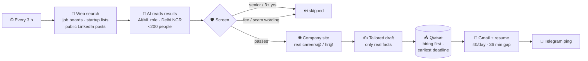

<div align="center">


### Finds AI/ML openings in Delhi NCR, skips senior and fake posts, and sends a tailored application from your Gmail — 40 a day, on autopilot.


[How it works](#-how-it-works) · [Screening](#-screening-rules) · [Sending](#-sending--queue) · [Telegram](#-telegram-commands) · [Quick start](#-quick-start) · [Deploy](#-deploy-to-azure) · [FAQ](#-faq)

</div>

---

## ✨ Highlights

<table>
<tr>
<td width="50%" valign="top">

**🎯 Only the right jobs**<br>
AI Engineer, ML, GenAI, LLM, NLP, computer vision, MLOps and data-science roles. Office, HR and sales jobs are dropped — even at AI companies.

</td>
<td width="50%" valign="top">

**🧑‍🎓 Matches your level**<br>
0–2 years, fresher or junior roles are sent. Senior / Lead / 3+ years roles are skipped before any email is written.

</td>
</tr>
<tr>
<td valign="top">

**🛡️ Scam-aware**<br>
Posts that ask for fees, promise guaranteed jobs or quick money, or accept applications only on WhatsApp are rejected.

</td>
<td valign="top">

**⏳ Deadline-first queue**<br>
Jobs closing soonest go out first. Expired ones are never sent, and Telegram warns you if one might miss its deadline.

</td>
</tr>
<tr>
<td valign="top">

**🐢 Inbox-safe pacing**<br>
At most 40 emails per day, at least 36 minutes apart, never the same address twice. Pauses itself on any Gmail error.

</td>
<td valign="top">

**💸 Cost-aware**<br>
Sleeps once the day's 40 are covered, caches repeated AI work, and tracks token usage in `/stats`.

</td>
</tr>
</table>

## 🔁 How it works

<p align="center"></p>



**A day in the life**

1. Every 3 hours the agent searches, screens and drafts — unless today's 40 emails are already sent or already waiting in the queue.
2. A worker checks the queue every minute and sends the next email once 36 minutes have passed.
3. After each email you get a short Telegram message. After the 40th: *"Sleeping until midnight IST."*
4. At midnight IST the limit resets. Leftover drafts go out first, then a fresh search starts.

## 🚦 Screening rules

| Check | ✅ Sent | ⏭️ Skipped |
|---|---|---|
| **Role** | AI / ML / GenAI / LLM / NLP / CV / MLOps / data science | HR, sales, marketing, office, support, unrelated tech |
| **Title** | anything else, incl. *Junior*, *Intern* | *Senior*, *Sr.*, *Lead*, *Principal*, *Staff*, *Manager* |
| **Experience** | 0–2 years, fresher, entry-level, or not mentioned | 3+ years (e.g. "3–5 yrs", "5+ years", "minimum 4 yrs") |
| **Fake-post signals** | — | registration / training / security fee or deposit · "pay before joining" · guaranteed job · no interview · "earn ₹X per day" · task-based income · WhatsApp/Telegram-only applications |
| **Contact** | company-domain address (`hr@company.com`) | only a personal Gmail/Yahoo/Outlook → **held for you on Telegram** |
| **Company** | own website, small, AI-focused, Delhi NCR | job boards, big companies, blocklist, `never_contact` |

> [!NOTE]
> Facts the AI extracts — experience lines, deadlines, email addresses — are only used if they appear **word-for-word in the source page**. An invented quote can't skip a good job or send to a made-up address.

## 📬 Sending & queue

| | |
|---|---|
| **Daily limit** | 40 attempts per India calendar day, resets at midnight IST |
| **Spacing** | at least 36 minutes between emails |
| **Order** | 🟢 advertised openings (earliest verified deadline first) → 🔵 outreach to AI companies with no posted opening |
| **Overflow** | stays queued and goes out first the next day |
| **Deadlines** | expired jobs are skipped; unclear deadlines are held for review; at-risk jobs trigger a Telegram alert with the job link |
| **Errors** | any SMTP error pauses sending — check Gmail *Sent*, then `/resume` |
| **Sleep** | no searching or AI drafting once today's 40 are sent or already queued |

## 📱 Telegram commands

| Command | What it does |
|---|---|
| `/stats` | counts by status, emails sent today, AI calls and tokens, sleep state |
| `/run` | search now, even while sleeping |
| `/pending` | show drafts waiting |
| `/skip <id>` | remove a queued email (e.g. you applied through the job link) |
| `/pause` · `/resume` | stop / restart searching and sending |

Held drafts arrive as a card with **✅ Send · 🔁 Rewrite · ❌ Skip**. Reply to a card with *"shorter"* or *"mention my computer-vision project"* to rewrite it, or `to: founder@company.com` to change the recipient.

<details>
<summary><b>🖼️ What a card looks like</b></summary>
<br>
<p align="center"></p>
<p align="center"><i>Example company; illustration only.</i></p>
</details>

## 🚀 Quick start

```bash
cd agent
pip install -r requirements.txt
cp .env.example .env          # Gmail app password, Telegram token, LLM key
python main.py --whoami       # message your bot first → prints your chat id for .env
python main.py --dry-run      # one search cycle, prints drafts, sends nothing
python main.py                # bot + scheduler
python -m pytest -q           # run the tests
```

Then make it yours:

- **`config.yaml`** — profile facts (the only facts drafts may use), cities, search queries, filters, sending limits.
- **`resume/build_resume.py`** — your resume. Run `python resume/build_resume.py` to rebuild the PDF.

<details>
<summary><b>⚙️ Key settings in <code>config.yaml</code></b></summary>

```yaml
search:
  cities: [Delhi, Noida, Gurgaon, ...]   # leads outside these are dropped
  every_hours: 3
filters:
  max_employees: 200                     # "small company" cutoff
  never_contact: [...]                   # never emailed, matched anywhere
  blocklist: [google, microsoft, ...]    # big companies and job boards
sending:
  auto_send: true                        # false = approve every email on Telegram
  daily_limit: 40
  min_gap_seconds: 2160                  # 36 minutes
```

</details>

## 🌐 Deploy to Azure

```bash
az login
bash deploy/azure/deploy.sh   # first run creates the VM; later runs push code + .env and restart
```

This creates a small Ubuntu VM and installs the agent as a `systemd` service. No inbound ports are opened — the bot only makes outbound connections.

## 🗂️ Project layout

```text
agent/
├── main.py            Telegram bot, scheduler, sleep logic, alerts
├── config.yaml        profile facts, cities, queries, filters, limits
├── jobagent/
│   ├── search.py      free multi-layer web search (+ optional Tavily), page fetch
│   ├── llm.py         company extraction and email drafting (Azure OpenAI / any OpenAI-compatible API)
│   ├── screening.py   experience level, fake-post signals, personal-address hold
│   ├── contacts.py    company website discovery, email scraping and ranking
│   ├── pipeline.py    one search → filter → screen → scrape → draft cycle
│   ├── deadlines.py   source-backed deadlines, queue slot projection
│   ├── sending.py     daily cap, spacing, duplicate and safety checks
│   ├── mailer.py      Gmail SMTP with resume attachment
│   └── db.py          SQLite: leads, statuses, seen URLs, AI usage, cache
├── resume/            resume source + generated PDF
└── tests/             41 unit tests
deploy/azure/          VM deploy script + systemd unit
```

## ❓ FAQ

<details>
<summary><b>Can someone use this repo to send email from my account?</b></summary>
<br>

**No.** The repo is code only. Everything that can send mail lives in `agent/.env`, which is git-ignored:

- the **Gmail app password** — without it, SMTP login fails;
- the **Telegram bot token** and **your chat id** — the bot ignores every other chat;
- the **Azure OpenAI key**.

If a secret ever leaks: revoke the app password at [myaccount.google.com/apppasswords](https://myaccount.google.com/apppasswords), send `/revoke` to @BotFather, and regenerate the Azure key.
</details>

<details>
<summary><b>Does it log in to LinkedIn?</b></summary>
<br>

No. It finds **public** LinkedIn posts through web search and reads what is publicly visible. Logging in to scrape LinkedIn breaks its terms and can get the account banned. Posts that are not indexed, are visible only when logged in, or say "DM me" can't be picked up.
</details>

<details>
<summary><b>What does it cost to run?</b></summary>
<br>

The VM is billed per hour whether or not it is busy. AI cost comes from reading search results and writing drafts. That stops once the day is covered, and identical inputs are cached for 7 days. Sending and Telegram messages make no AI calls. `/stats` shows the day's calls and tokens; these are usage indicators, not your Azure bill.
</details>

<details>
<summary><b>Will Gmail mark me as a spammer?</b></summary>
<br>

Pacing, a modest daily volume, verified addresses and personalised content all help, but no limit guarantees inbox placement. Forty is a ceiling, not a target.
</details>

<details>
<summary><b>Can it catch every fake job?</b></summary>
<br>

No. It catches the common patterns. A scammer with a real-looking website and no fee wording can still get through. **A real employer never asks you to pay to apply.**
</details>

---

<div align="center">
<sub>Built with Python · Azure OpenAI · python-telegram-bot · APScheduler · SQLite · MIT licensed</sub>
</div>
