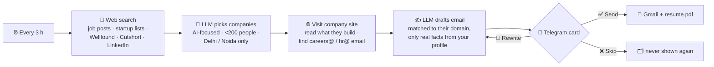

## Current personal deployment: automatic AI/ML applications

Automatic sending is enabled, capped at 40 attempts per India calendar day and
per rolling 24 hours, spaced at least 36 minutes apart. Only advertised technical
AI/ML roles whose title is found in their source result qualify. Office, HR,
sales, marketing and general unrelated roles are excluded even at AI companies.
Legacy drafts without the new source validation are not automatically sent.
A minute-by-minute worker drains eligible pending drafts across search cycles.
SMTP failures pause sending and retain uncertain deliveries for manual review;
check Gmail Sent before using /resume. /pause stops discovery and sending.
Successful sends produce a short Telegram message via the normal free Bot API;
no paid broadcasts or additional AI calls are used for notifications.
Forty is a ceiling, not a guaranteed daily target or a guarantee against spam
classification. The historical approval-mode documentation below applies when
`auto_send` is disabled; sending still requires the current role validation.

<div align="center">


**Finds small AI startups in Delhi & Noida, writes each one a tailored application, and sends it from your Gmail — but only after you tap ✅ on Telegram.**


</div>

---

## Why

Big companies route applications through portals and ATS filters. Small AI startups often don't have a hiring pipeline at all — a short, specific email to the right inbox gets read. Finding those startups, their real contact address and what they build, then writing a non-generic email for each, is hours of work a day. This agent does that part, and leaves the decision to you.

## How it works

<p align="center"></p>

<details>
<summary>Detailed flow</summary>



</details>

## Your approval card

<table>
<tr>
<td width="50%"></td>
<td>

Every card tells you:

- **Why** this company was picked: 🟢 *hiring for a role*, or 🔵 *AI company, writing to HR*
- **What they build**, so you can judge fit in two seconds
- **Where the address came from**: a link to the page it was found on
- The **full draft**, with your resume attached

Then tap **✅ Send**, **🔁 Rewrite** or **❌ Skip**.

*(Example company; illustration only.)*

</td>
</tr>
</table>

Reply to a card with *"shorter"* or *"mention my computer-vision project"* to get a rewrite, or with `to: founder@company.com` to change the recipient.

## Features

Search includes public LinkedIn posts and feed updates as well as job listings.
When a qualifying hiring post explicitly mentions an application email, the agent
verifies it against that specific result and shows it with the source URL on the
Telegram card, preferring it over generic website contacts. Search snippets are
preserved when LinkedIn returns a sign-in page. Posts unavailable to public search
cannot be discovered. Company filters, duplicate handling, and Send/Rewrite/Skip
approval remain unchanged; website email discovery remains the fallback.

Discovery rotates role/city/source combinations each cycle, searches the past week
when results are exhausted, and explores pages 2–4. Seen pages become eligible for
refresh after three days. Up to five old missing-contact or draft-generation
failures are retried each cycle after a three-day cooldown. Sent, skipped, pending,
blocked, and send-failed leads are not reset. Failed extraction batches remain
available for retry. These settings improve coverage; daily volume still depends
on public search coverage and how many companies meet the configured filters.

### Avoiding repeat AI costs

Successful company-extraction batches are cached in SQLite for seven days when
their complete source text, model/deployment endpoint, and extraction instructions
are identical. Changed content is processed immediately; expired entries are
removed as new results are cached. Drafts and requested rewrites remain fresh.
Set `efficiency.extraction_cache_days: 0` to disable reuse.
The Telegram `/stats` command shows successful API response counts, input/output
tokens, and cache hits for the current UTC day, starting from this update.
These counters are usage indicators, not an Azure billing total: provider-side
retries, rates, credits, and other resources affect the actual charge.

| | |
|---|---|
| 🎯 **Targeted** | Small AI companies only; big-company and job-board blocklist; city filter |
| ✋ **Human-in-the-loop** | Nothing is sent until you approve it on Telegram |
| 🧾 **No invented facts** | Drafts may only use the facts listed in `config.yaml` |
| 📬 **Real addresses** | Emails are scraped from the company's own site; LLM-reported addresses are dropped unless they appear verbatim in the source |
| 🔁 **Never twice** | One row per company domain in SQLite — nobody is contacted twice |
| 🐢 **Inbox-safe** | Daily cap (20) and a gap between sends to keep your Gmail out of spam |
| ☁️ **Always on** | systemd service on a free-tier Azure VM, no inbound ports |

## Can someone use this repo to send email from my account?

**No.** The repo contains code only. Everything that could send mail is in `agent/.env`, which is git-ignored and exists only on your machine and your server:

- the **Gmail app password** — without it, SMTP login fails;
- the **Telegram bot token** and **your chat id** — the bot ignores every chat except yours, so a stranger who finds the bot can't trigger a send;
- the **Azure OpenAI key**.

Anyone who clones the repo has to supply their own Gmail, bot and LLM keys, and can only ever send from *their* account. If a secret ever leaks: revoke the app password at [myaccount.google.com/apppasswords](https://myaccount.google.com/apppasswords), send `/revoke` to @BotFather, and regenerate the Azure key.

## Use it yourself

```bash
cd agent
pip install -r requirements.txt
cp .env.example .env          # fill in Gmail app password, Telegram token, LLM key
python main.py --whoami       # message your bot first; prints your chat id → .env
python main.py --dry-run      # one search cycle, prints drafts, sends nothing
python main.py                # run the bot + scheduler
```

Edit `config.yaml` for your own profile facts, cities, search queries and limits, and `resume/build_resume.py` for your resume (`python resume/build_resume.py` rebuilds the PDF).

**Telegram commands:** `/run` search now · `/pending` drafts waiting · `/stats` · `/pause` · `/resume`

### Deploy to Azure

```bash
az login
bash deploy/azure/deploy.sh   # creates the VM on first run; later runs push code + .env and restart
```

Creates an Ubuntu VM (free-tier size), installs the agent as a systemd service, and opens no inbound ports — the bot only makes outbound connections.

## Project layout

```
agent/
  main.py              Telegram bot, approval buttons, scheduler
  config.yaml          profile facts, cities, queries, filters, send limits
  jobagent/
    search.py          DuckDuckGo / Tavily search + page fetch
    llm.py             company extraction and email drafting (Azure OpenAI or any OpenAI-compatible API)
    contacts.py        website discovery, email scraping and ranking, blocklists
    pipeline.py        one search → filter → scrape → draft cycle
    mailer.py          Gmail SMTP with resume attachment
    db.py              SQLite: companies, statuses, seen URLs
  resume/              resume source + generated PDF
deploy/azure/          VM deploy script + systemd unit
```
